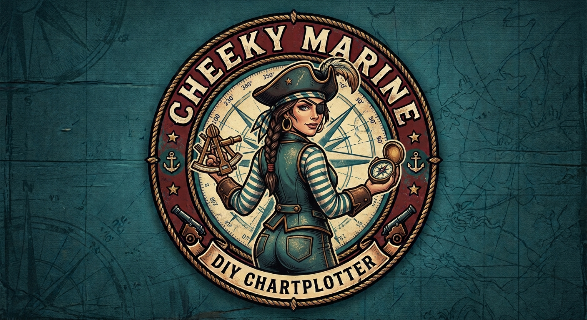

# CheekyMarine

<p align="center"></p>

A DIY second helm display for a small boat: an NMEA 2000 daemon, chart packs and a Qt chart plotter on a Raspberry Pi 5. Design: `docs/superpowers/specs/2026-10-28-cheekymarine-design.md`.

`n2kd` is a C++ NMEA 2000 daemon.

## Build and test

```bash
cmake -S . -B build
cmake --build build -j
ctest --test-dir build --output-on-failure
```

## Running n2kd

```
n2kd (--can IFACE | --replay FILE) [options]
  --can IFACE     read live frames from a SocketCAN interface (e.g. can0)
  --replay FILE   replay a candump -L or canboat RAW log
  --speed N       replay speed factor >= 0.001, 0 = as fast as possible (default 1)
  --socket PATH   Unix socket to serve JSON on (default /run/cheekymarine/n2k.sock)
  --stdout        print JSON snapshots to stdout instead of serving a socket
  --rawlog DIR    write raw frames to rotating candump -L files in DIR
  --pgns PATH     canboat.json PGN database (default: installed copy, else source tree)
  --hz N          publish rate in Hz (default 2)
  --claim         send an ISO address claim on the CAN bus (experimental, off by default)
  --no-claim      do not send an address claim (the default; accepted for compatibility)
  --help, --version
```

Replay example:

```bash
build/n2kd/n2kd --replay n2kd/tests/fixtures/garmin-airmar.log --speed 5 --stdout
```

Behavior:

- Snapshots go out at `--hz`: a `vessel` snapshot every tick, and an `ais` snapshot when targets exist and either their content (ignoring `t` and per-target `age` and `posAge`) changed since the last one sent or a new client connected, plus one empty-targets `ais` snapshot when the last target expires. Socket clients first receive a `hello` line; `--stdout` prints snapshots only, one JSON object per line.
- Live ticks are scheduled on the monotonic clock, so wall clock steps do not pause publishing; snapshots carry wall time. In replay mode the clock is the timestamp of the last frame read, so freshness and ticks follow the log, not the wall clock. A final snapshot is printed at end of file, then n2kd exits 0.
- With `--can`, if the interface cannot be opened n2kd logs once and retries every 5 s while still serving clients. By default n2kd is a listen-only node and never transmits. Address claiming is experimental and off by default: with `--claim` it sends one ISO address claim (PGN 60928, fixed unique number) from the null address after opening, with no arbitration and no reply to ISO Request. A later plan implements proper claiming and arbitration from a non-null address.
- If the socket's parent directory is missing it is created.
- Exit codes: 0 clean stop (SIGTERM/SIGINT) or end of replay; 1 bad options, unopenable replay file or socket; 2 unreadable or unparsable `canboat.json`.

`cmake --install build` installs `bin/n2kd`, `share/cheekymarine/canboat.json` and `lib/systemd/system/n2kd.service` under `CMAKE_INSTALL_PREFIX` (default `/usr/local`; configure with `-DCMAKE_INSTALL_PREFIX=/usr` to match the release tarballs). The unit is generated at configure time so its `ExecStart` points at the installed binary. The default `--pgns` is the installed `canboat.json`; builds with `-DN2K_SOURCE_PGNS_FALLBACK=ON` (the default) also fall back to the source tree copy, release builds turn it off.

The unit runs n2kd as user and group `cheekymarine`, so the socket `/run/cheekymarine/n2k.sock` is owned by that group with mode 0660. The image plan creates the `cheekymarine` user and adds the app user to the `cheekymarine` group so it can open the socket. On a hand-built system create them yourself, for example `sudo useradd --system --no-create-home --shell /usr/sbin/nologin cheekymarine` and `sudo usermod -aG cheekymarine APPUSER`.

## JSON messages

Each message is one JSON object per line. Socket clients first receive `{"type":"hello","schema":1,"version":"X.Y.Z"}`.

Vessel snapshot (every tick):

```json
{"type":"vessel","t":1700000000.5,
 "pos":{"lat":47.6062,"lon":-122.3321},"sog":3.29,"cog":3.735,"hdg":3.6739,"hdgRef":"Magnetic",
 "depth":14.42,"depthOffset":-0.3,"stw":null,"waterTemp":287.65,"gnssTime":null,"sats":null,"rpm":null}
```

AIS snapshot:

```json
{"type":"ais","t":1700000000.5,"targets":[{"mmsi":367123450,"class":"A","lat":47.7,"lon":-122.4,"sog":3.29,
 "cog":3.735,"hdg":3.6739,"name":null,"callsign":null,"shipType":null,"navStatus":0,"age":2.5,"posAge":2.5}]}
```

Units are the NMEA 2000 SI units canboat reports: `t` and `gnssTime` epoch seconds, `lat`/`lon` degrees, `sog` and `stw` m/s, `cog` (true) and `hdg` radians, `depth` and `depthOffset` meters (`depthOffset` positive to the waterline, negative to the keel), `waterTemp` kelvin, `rpm` revolutions per minute, `sats` a count. `hdgRef` is `"True"` or `"Magnetic"`. Stale or unknown vessel values are `null`. In AIS targets, `class` is `"A"` or `"B"`, `shipType` and `navStatus` are the AIS codes, `age` is seconds since any message from the target, and `posAge` is seconds since the last position report with a valid latitude and longitude (`null` if none yet). A position report that marks a field not available clears it (`null`), so `lat`/`lon` never show an old position as current.

## Cutting a release

1. Bump `VERSION` in the `project(...)` line of the root `CMakeLists.txt` and commit.
2. Tag and push: `git tag vX.Y.Z && git push origin vX.Y.Z`.

The `Release` workflow runs on the tag, builds and tests x86_64, cross-builds aarch64 (fully static), and attaches `n2kd-X.Y.Z-x86_64.tar.gz` and `n2kd-X.Y.Z-aarch64.tar.gz` to a GitHub release. Each tarball holds one top-level directory `n2kd-X.Y.Z-ARCH/` containing an install tree for prefix `/usr` (`usr/bin/n2kd`, `usr/share/cheekymarine/canboat.json`, `usr/lib/systemd/system/n2kd.service`) plus `LICENSE`, `canboat-LICENSE`, `THIRD_PARTY_NOTICES` and `SHA256SUMS`. `scripts/package-n2kd.sh BUILD_DIR VERSION ARCH` builds it from a build configured with `-DCMAKE_INSTALL_PREFIX=/usr`.

The tag must equal the CMake project version (`scripts/check-version-tag.sh vX.Y.Z` checks this locally), otherwise the workflow fails before building.

The aarch64 tarball is statically linked and runs on any 64-bit Raspberry Pi OS. The x86_64 tarball is dynamically linked and needs glibc 2.38 or newer (Ubuntu 24.04 class).

To install, extract only the `usr` tree onto `/` (the licenses and checksums stay out of `/`):

```bash
sudo tar -C / --strip-components=1 --no-overwrite-dir -xzf n2kd-X.Y.Z-aarch64.tar.gz n2kd-X.Y.Z-aarch64/usr
sudo systemctl daemon-reload
```

The installed `n2kd` finds `canboat.json` at `/usr/share/cheekymarine/canboat.json` by default.
